# Islamic Desktop Widgets

Three widgets for Ubuntu GNOME. The **Ayah reminder** shows a daily Qur’an verse in Arabic with an English translation. The **Clock** shows the time and date. The **Avatar** can stand and walk on the clock, fall back to its own desktop position, and react to music or Qur’an playback.

## How it fits together

The GTK settings app changes visibility, card themes and placement through one desktop bridge. The GNOME implementation uses GSettings and AzClock 16.1. AzClock keeps the widgets visible after settings closes. Blender renders the avatar frames offline. The packaging tools crop and pack them for the GNOME renderer, which uses C++ for motion and launches a C++ audio player on demand.

[](docs/repository-overview.html)

| Directory | Contents |
| --- | --- |
| `desktop_widgets/widgets/ayah/` | Ayah reminder theme presets |
| `desktop_widgets/widgets/clock/` | Clock theme presets |
| `desktop_widgets/widgets/avatar/` | Motion, music and Qur’an playback |
| `desktop_widgets/bridge/` | Shared GNOME/AzClock integration, panel, placement and rendering |
| `desktop_widgets/app.py` | GTK settings window and commands |
| `character/3d/` | Blender scene, rig, actions and offline renders |
| `packaging/` and `tests/` | Ubuntu package, preview and verification |

## Build and install

Install the Ubuntu build dependencies and use Blender 5 to render the walk and listening frames as described in the [avatar build guide](docs/avatar-pilot.md).

```sh
sudo apt install build-essential dpkg-dev pkg-config gobject-introspection \
  libglib2.0-dev libgtk-4-dev libgstreamer1.0-dev python3-gi python3-pil
```

Build and install from the repository root. The commands stop at the first failure, and `--reinstall` lets APT replace an installed copy of the same version.

```sh
sh packaging/build-deb.sh &&
  sudo apt install --reinstall "./dist/desktop-widget-settings_0.6.5_$(dpkg --print-architecture).deb" &&
  desktop-widget-settings --install-gnome-integration
```

The last command backs up a local AzClock 16.1 installation and transfers ownership from the legacy desktop avatar service. Log out and back in to load the bridge. The GNOME configuration needs the existing widget IDs `ayah/verse`, `clock/card` and `avatar/body`. For development, use the [isolated preview and checks](docs/avatar-pilot.md#verification).

## Clock faces and themes

In **Clock**, choose the face language before choosing a theme. The English face places the avatar on the right of the clock. The Arabic face uses Arabic numerals and right-to-left text and places the avatar on the left.

Open a family in **Themes** to preview its A and B illustrations. **Both** shows the Ayah and the English and Arabic clock faces together. Choose **Clock** or **Ayah** to apply to one widget. Adjust the artwork and text opacity before applying. The Clock and Ayah illustrations tell separate parts of the same story. Each widget’s appearance editor can save a named custom theme to the library.

## Ayah screenshot check

From a graphical session with AzClock and the bundled fonts installed, run this from the repository root.

```sh
/usr/bin/python3 tests/capture_ayah.py
```

The check renders short, multi-ayah, and long passages on fixed light and dark wallpapers at 45% card opacity. It also captures the end of the long passage at 160% text scale. Screenshots go to `dist/ayah-preview/regression/`. Use `--theme` to review a specific preset or `--quran-data` to point to a different directory containing the widget’s local `quran-uthmani.json` and `en.sahih.json` files.
